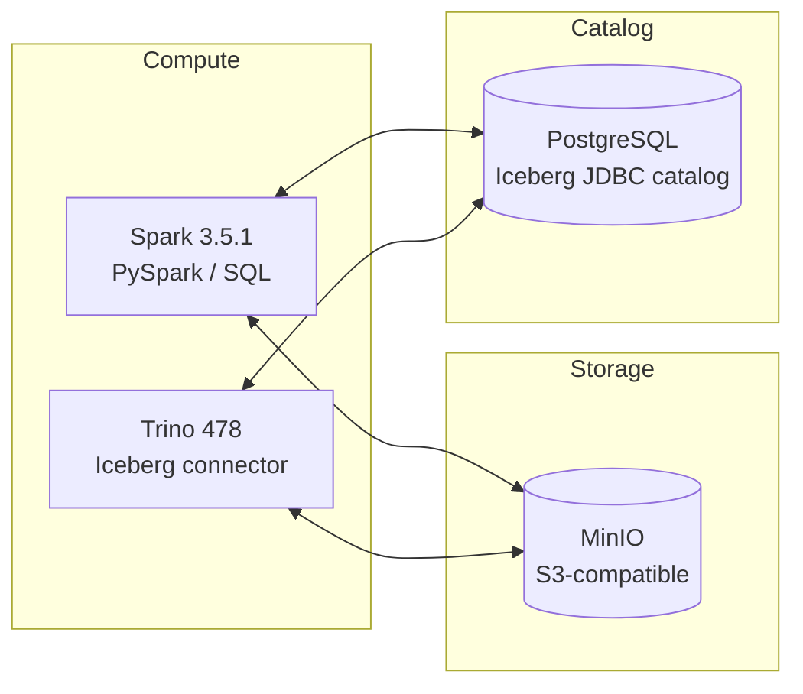

# Lakehouse без магии: локальный стенд и учебные материалы

Этот репозиторий объединяет:

- локальный Lakehouse-стенд на `Spark + Trino + Iceberg + MinIO + PostgreSQL`;
- учебный курс `Lakehouse без магии`, который использует этот стенд как практическую среду;
- стартовые ноутбуки и demo-скрипты для первых экспериментов.

Репозиторий рассчитан не на «универсальную платформу для всего», а на понятную локальную песочницу, где можно руками пройти путь от запуска стенда до чтения одной и той же Iceberg-таблицы из `Spark` и `Trino`.

## Архитектура



Коротко по ролям:

- `MinIO` хранит данные и служебные файлы Iceberg.
- `PostgreSQL` хранит метаданные JDBC-каталога `lakehouse`.
- `Spark` и `Trino` работают как два compute-движка поверх одного storage и одного catalog.
- `Jupyter` служит точкой входа в практическую часть курса.

## С чего начать

Если ты заходишь в репозиторий впервые, используй такой маршрут:

1. Открой [START_HERE.md](./START_HERE.md) для первого запуска стенда и базовой диагностики.
2. После старта стенда выполни `notebooks/01_environment_and_smoke_test.ipynb`.
3. Для структуры курса смотри [docs/course_program.md](./docs/course_program.md).

Если нужен только краткий запуск, из корня репозитория достаточно:

```bash
docker compose build
docker compose up -d
docker compose ps
```

Основные UI после старта:

- Spark Master UI: `http://localhost:8080`
- Trino UI: `http://localhost:8090`
- MinIO Console: `http://localhost:9001`
- JupyterLab: `http://localhost:8888`

Полный onboarding, диагностика и reset-сценарии находятся в `START_HERE.md`.

## Как устроен репозиторий

| Где | Что лежит |
| --- | --- |
| `docker-compose.yml` | состав сервисов стенда, порты, сети, init-контейнеры |
| `spark/` | Dockerfile и конфиг Spark для Iceberg + MinIO |
| `trino/` | каталог `lakehouse` и настройки Trino |
| `jupyter/` | образ JupyterLab на базе Spark-образа |
| `notebooks/` | практические ноутбуки курса |
| `src/` | smoke-скрипты, SQL-демо и helper-логика |
| `docs/` | PRD, программа курса, reference-документы |
| `plans/` | внутренние living docs по развитию материалов |

## Основные документы для прохождения

- [START_HERE.md](./START_HERE.md) — первый маршрут для студента.
- [docs/course_program.md](./docs/course_program.md) — модульная структура и состав учебных материалов.
- [docs/stack_reference.md](./docs/stack_reference.md) — технический reference по сервисам, портам, конфигам и smoke-тестам.

## Что уже можно делать в стенде

- поднять локальный кластер `Spark` с двумя worker-ами;
- создать Iceberg-таблицу из `Spark`;
- прочитать ту же таблицу из `Trino`;
- пройти базовый smoke test через ноутбук или demo-скрипты;
- использовать стенд как основу для следующих модулей курса.

## Куда смотреть за техническими деталями

- [docs/stack_reference.md](./docs/stack_reference.md) — сервисы, порты, доступ, reset, smoke tests;
- [spark/spark-defaults.conf](./spark/spark-defaults.conf) — конфигурация Spark-каталога `lakehouse`;
- [trino/catalog/lakehouse.properties](./trino/catalog/lakehouse.properties) — конфигурация каталога Trino;
- [docker-compose.yml](./docker-compose.yml) — фактический состав стенда.

## Лицензия

Материалы этого репозитория лицензированы на условиях Creative Commons Attribution 4.0 International (`CC BY 4.0`).
См. [LICENSE](./LICENSE).
