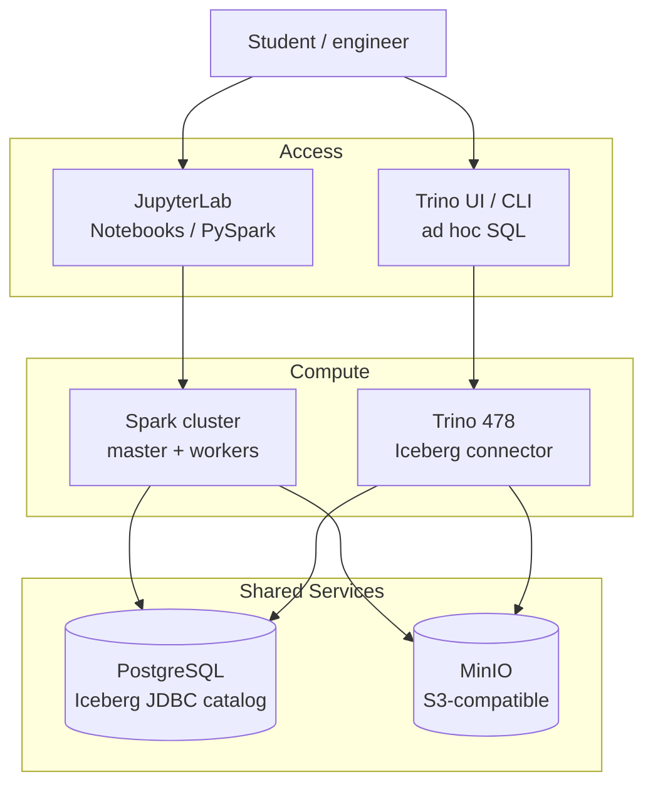

# Lakehouse без магии

Все порты стенда публикуются только на `127.0.0.1`. На удалённой машине открывай нужные интерфейсы через SSH-туннель; прямой доступ по внешнему IP закрыт.

Практический курс, после которого ты будешь уверенно работать с Lakehouse-стеком: поднимать стенд, строить пайплайн `raw -> bronze -> silver`, читать одну таблицу из двух движков и не бояться изменений в данных.

## Что ты получишь

После прохождения 8 модулей ты умеешь:

1. **Поднимать и диагностировать** локальный Lakehouse-стенд — не по инструкции, а с пониманием, что и зачем работает.
2. **Объяснять архитектуру** `storage + catalog + compute` — и видеть, как знакомые концепции из PostgreSQL/Greenplum ложатся на новый стек.
3. **Строить пайплайн** `raw -> bronze -> silver` на реальном датасете NYC Taxi — с проверками качества и воспроизводимостью.
4. **Работать с двумя движками** — записывать данные через Spark, читать через Trino, и понимать, почему это работает без копирования.
5. **Безопасно менять таблицы** — schema evolution, time travel, rollback к предыдущему состоянию вместо паники.
6. **Обслуживать таблицы** — compaction и expire_snapshots, с пониманием параллелей к VACUUM/REORGANIZE.

Курс рассчитан на `~12-15 часов` самостоятельной работы. Каждый модуль: объяснение, демонстрация, самостоятельное задание, checkpoint.

## Стек

Всё работает локально в Docker. Для первой сборки и скачивания учебных данных
нужен интернет; облачный аккаунт не требуется.



| Компонент | Роль в стенде |
| --- | --- |
| `MinIO` | Storage — хранит данные и служебные файлы Iceberg |
| `PostgreSQL` | Catalog — метаданные JDBC-каталога `lakehouse` |
| `Spark` | Compute — ETL, запись и чтение Iceberg-таблиц |
| `Trino` | Compute — ad hoc SQL, чтение тех же таблиц |
| `JupyterLab` | Основной интерфейс — ноутбуки курса, Python и терминал внутри Docker |
| `code-server` | VS Code в браузере — альтернативный интерфейс для тех же ноутбуков |

Ноутбуки подключаются к Spark-кластеру с
[готовыми настройками стенда](./docs/stack_reference.md#spark).

## С чего начать

1. Открой [START_HERE.md](./START_HERE.md) — подготовка, запуск и первый ноутбук
   с ожидаемым результатом.
2. Продолжи по [маршруту из восьми модулей](./docs/course_program.md#маршрут-по-модулям).
3. Между занятиями используй [памятку учащегося](./docs/study_workflow.md):
   остановка, продолжение работы и диагностика.

Для одного учащегося рекомендуем компьютер с 16 ГБ RAM, не менее 4 CPU и
ориентировочно 8 ГБ памяти для Docker, а также от 20 ГБ свободного места перед сборкой.
Trino ограничен 2 ГиБ памяти контейнера и 1 ГиБ Java heap.
Подробности и границы проверки — в [системных требованиях](./START_HERE.md#системные-требования).

Краткий запуск из корня репозитория после подготовки по `START_HERE`:

```bash
docker compose pull minio minio-init postgres trino
docker compose build
docker compose up -d
docker compose ps -a
```

MinIO скачивается готовым из GHCR, его версия и digest закреплены. Если какой-то
источник недоступен из твоей сети, начни с
[инструкции по доступу к репозиториям](./docs/network_access.md).

После старта:

| UI | Адрес |
| --- | --- |
| JupyterLab | `http://localhost:8888` |
| VS Code в браузере (по желанию) | `http://localhost:8889` |
| Spark Master | `http://localhost:8080` |
| Trino | `http://localhost:8090` |
| MinIO Console | `http://localhost:9001` |

Открой ноутбук в JupyterLab: Python работает внутри контейнера, локальный
Python и venv не нужны. JupyterLab доступен только с хоста стенда.
Первый запуск ноутбука описан в [START_HERE.md](./START_HERE.md#как-работать-с-ноутбуками).

VS Code запускается вместе со стендом. Его можно использовать по желанию;
он совместим не со всеми сочетаниями браузера, расширений и средств защиты.
[Выбор ядра и доступ к удалённому стенду](./docs/stack_reference.md#vs-code-в-браузере).

## Документы для прохождения

- [START_HERE.md](./START_HERE.md) — подготовка компьютера, запуск и первый результат.
- [docs/study_workflow.md](./docs/study_workflow.md) — памятка для каждого занятия и помощь при ошибках.
- [docs/course_program.md](./docs/course_program.md) — модульная структура и состав учебных материалов.
- [docs/stack_reference.md](./docs/stack_reference.md) — порты, команды, конфиги, шпаргалка.
- [docs/glossary.md](./docs/glossary.md) — справочник терминов (storage, catalog, compute, snapshot и др.).

## Менторство

Курс рассчитан на самостоятельное прохождение, но если хочешь разобрать темы глубже с ментором по Data Engineering — напиши: [@dementev_dev](https://t.me/dementev_dev).

## Лицензия

Материалы этого репозитория лицензированы на условиях Creative Commons Attribution 4.0 International (`CC BY 4.0`).
См. [LICENSE](./LICENSE).
