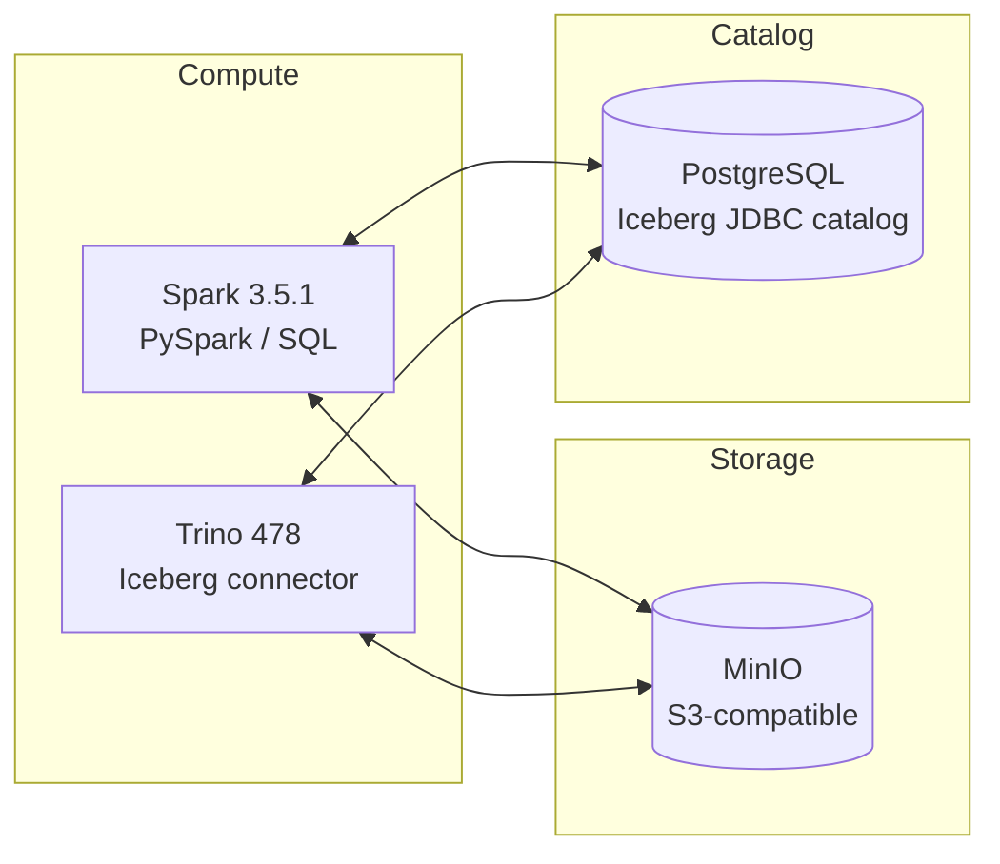

# Учебный Lakehouse-стенд (Trino + Spark + Iceberg + MinIO)

Учебный стенд для демонстрации **Lakehouse-архитектуры** на одном ноутбуке:

- объектное хранилище S3-класса (MinIO),
- движок запросов Trino,
- Spark для batch/ETL и интерактивных экспериментов,
- формат таблиц Iceberg,
- JDBC-каталог (PostgreSQL) для метаданных Iceberg в Trino,
- конфиг Spark, заточенный под работу с Iceberg + S3.

Стенд ориентирован на обучение менти и быструю демонстрацию концепции Lakehouse: разделение **storage / compute / catalog** без лишней обвязки (Hive Metastore, полноценный Hadoop-кластер и т.п.).

---

## Архитектура



**Основные идеи:**

* **Данные** (Parquet-файлы + служебные каталоги Iceberg) лежат в бакете MinIO (`s3a://lakehouse/warehouse/...`).
* **Метаданные** Iceberg хранятся в PostgreSQL (JDBC-каталог `lakehouse`).
* **Spark и Trino** используют один и тот же JDBC-каталог: таблицы, созданные в Spark, доступны в Trino, и наоборот.

---

## Быстрый старт

1. Установить Docker и Docker Compose (см. раздел «Требования» ниже).
2. В корне репозитория выполнить:

   ```bash
   docker compose build
   docker compose up -d
   ```

3. Открыть основные интерфейсы:

   - Trino Web UI: `http://localhost:8090`
   - MinIO Console: `http://localhost:9001`
   - JupyterLab (если включён): `http://localhost:8888`

4. Для пошаговых лабораторных работ см. файл `HOWTO.md`.

---

## Состав репозитория

* `docker-compose.yml` — описание всех сервисов стенда:

  * Spark master / worker(ы) на базе кастомного образа `spark-iceberg`,
  * Trino,
  * MinIO (S3-совместимое хранилище),
  * PostgreSQL под Iceberg JDBC-каталог,
  * (опционально) Jupyter / notebook для PySpark.
* `spark/Dockerfile` — сборка кастомного образа **Spark** с зависимостями:

  * `hadoop-aws`, `aws-java-sdk`,
  * библиотека Iceberg нужной версии,
  * `pyspark`, `pyarrow` и базовый набор инструментов.
* `jupyter/Dockerfile` — образ JupyterLab на базе Spark-образа.
* `spark/spark-defaults.conf` — конфигурация Spark для работы с:

  * Iceberg-каталогом `lakehouse` (тип `jdbc`, метаданные в Postgres),
  * MinIO через `s3a://`,
  * расширениями `IcebergSparkSessionExtensions`.
* `src/` — учебные примеры для Spark и Trino:

  * `src/spark/cluster_smoke.py` — проверка, что кластер жив (Spark master/worker).
  * `src/spark/iceberg_smoke.py` — Spark создаёт Iceberg-таблицу и читает её.
  * `src/spark/iceberg_demo.sql` — пример создания Iceberg-таблицы через Spark SQL.
  * `src/trino/iceberg_smoke.sql` — Trino читает таблицу, созданную в Spark.
* `trino/catalog/lakehouse.properties` — конфиг каталога Trino `lakehouse`:

  * коннектор `iceberg`,
  * `jdbc`-каталог (PostgreSQL),
  * доступ к MinIO как к S3-хранилищу.

---

## Требования

- Docker и Docker Compose.
- Порты по умолчанию должны быть свободны (см. таблицу «Сервисы и порты» ниже).

### Сервисы и порты

| Сервис                 | Контейнер         | Порт (host → container) | Назначение / UI                     |
|------------------------|-------------------|-------------------------|-------------------------------------|
| Trino                  | `trino`           | `8090 → 8080`           | Web UI Trino                        |
| MinIO API              | `minio`           | `9000 → 9000`           | S3 endpoint                         |
| MinIO Console          | `minio`           | `9001 → 9001`           | Веб-консоль MinIO                   |
| PostgreSQL (каталог)   | `postgres-iceberg`| `5432 → 5432`           | Доступ для psql/DBeaver и т.п.      |
| Spark master UI        | `spark-master`    | `8080 → 8080`           | Web UI мастера Spark                |
| Spark worker-1 UI      | `spark-worker-1`  | `8081 → 8081`           | Web UI первого воркера              |
| Spark worker-2 UI      | `spark-worker-2`  | `8082 → 8081`           | Web UI второго воркера (host 8082)  |
| JupyterLab             | `jupyter`         | `8888 → 8888`           | JupyterLab с PySpark                |

---

## Сборка и запуск

Все команды в этом разделе выполняются из корня репозитория.

### 1. Собрать образы

```bash
docker compose build
```

Будут собраны кастомные образы Spark/Jupyter с зависимостями Iceberg, S3A, JDBC-драйвером Postgres и Python-библиотеками.

### 2. Поднять стенд

```bash
docker compose up -d
```

Что происходит при старте:

* MinIO поднимается с root-пользователем/паролем (по умолчанию смотри в `docker-compose.yml`, обычно `minioadmin/minioadmin`), init-контейнер создаёт бакет `lakehouse`.
* PostgreSQL под каталог Iceberg создаёт БД и пользователя (значения — в `docker-compose.yml` / `.env`).
* Trino стартует с каталогом `lakehouse`, описанным в `lakehouse.properties`.
* Spark master/worker получают конфиг из `spark-defaults.conf` (общий JDBC-каталог Iceberg + MinIO).

Проверить статус:

```bash
docker compose ps
```

### 3. Остановить стенд и очистить данные

Чтобы остановить все сервисы и удалить данные в MinIO/PostgreSQL (Docker volumes), можно выполнить:

```bash
docker compose down -v
```

---

## Доступ к сервисам

### Trino

Web UI (координатор):

```text
http://localhost:8090
```

(точный порт см. в `docker-compose.yml`).

Подключение **из контейнера trino**:

```bash
docker exec -it trino trino \
  --server http://localhost:8080 \
  --catalog lakehouse
```

Проверка:

```sql
SHOW CATALOGS;
SHOW SCHEMAS FROM lakehouse;
```

### MinIO

* Консоль: `http://localhost:9001`
* S3 endpoint: `http://localhost:9000`

Учётные данные — `MINIO_ROOT_USER` / `MINIO_ROOT_PASSWORD` из `docker-compose.yml` или `.env`.

Создай в MinIO бакет `lakehouse` (если его нет) — данные Iceberg будут храниться именно там.

### PostgreSQL (каталог Iceberg для Trino)

Подключение (пример):

```bash
psql -h localhost -p 5432 -U iceberg -d iceberg
```

(имя пользователя, БД и порт уточняются в `docker-compose.yml`).

Служебные таблицы Iceberg JDBC-каталога (`iceberg_tables`, `iceberg_namespace_properties`) создаёт однократный контейнер `iceberg-catalog-init`. Если база уже запускалась без них, можно переинициализировать вручную:

```bash
docker compose run --rm iceberg-catalog-init
```

### Jupyter / notebooks

Веб-интерфейс: `http://localhost:8888` (по умолчанию без токена).

* В контейнере монтируется `./notebooks` в `/opt/work`.
* `./src` доступен read-only в `/opt/src`, переменная `PYTHONPATH=/opt/src` уже установлена — можно импортировать функции из скриптов прямо в ноутбуках.

---

## Конфигурация Trino (каталог `lakehouse`)

Файл `lakehouse.properties` монтируется в `/etc/trino/catalog/lakehouse.properties`.

Ключевые параметры:

```properties
connector.name=iceberg

# Каталог Iceberg типа JDBC (метаданные в PostgreSQL)
iceberg.catalog.type=jdbc
iceberg.jdbc-catalog.catalog-name=lakehouse
iceberg.jdbc-catalog.driver-class=org.postgresql.Driver
iceberg.jdbc-catalog.connection-url=jdbc:postgresql://postgres-iceberg:5432/iceberg
iceberg.jdbc-catalog.connection-user=iceberg
iceberg.jdbc-catalog.connection-password=iceberg
iceberg.jdbc-catalog.schema-version=V1

# Хранилище файлов Iceberg – S3 (MinIO) через hadoop-клиент
iceberg.file-system.type=hadoop
fs.native-s3.enabled=true

s3.endpoint=http://minio:9000
s3.region=us-east-1
s3.path-style-access=true
s3.aws-access-key=minioadmin
s3.aws-secret-key=minioadmin
```

**Что это даёт:**

* Trino хранит *метаданные* Iceberg в PostgreSQL (таблицы каталога, снапшоты, манифесты и т.п.).
* *Файлы данных* лежат в MinIO, в бакете `lakehouse`, к которому Trino ходит по `s3://`/`s3a://` через S3-клиент.

Пример создания схемы и таблицы из Trino:

```sql
-- Схема в каталоге lakehouse (метаданные в PostgreSQL)
CREATE SCHEMA lakehouse.default;

-- Таблица Iceberg с данными в s3://lakehouse/default/test_table/
CREATE TABLE lakehouse.default.test_table (
    id   bigint,
    name varchar
);
```

---

## Конфигурация Spark (spark-defaults.conf)

`spark-defaults.conf` монтируется в `/opt/spark/conf/spark-defaults.conf` в контейнеры Spark.

Ключевые моменты:

```properties
# Iceberg Spark extensions
spark.sql.extensions=org.apache.iceberg.spark.extensions.IcebergSparkSessionExtensions

# Каталог Iceberg для Spark (JDBC, метаданные в Postgres)
spark.sql.catalog.lakehouse=org.apache.iceberg.spark.SparkCatalog
spark.sql.catalog.lakehouse.catalog-impl=org.apache.iceberg.jdbc.JdbcCatalog
spark.sql.catalog.lakehouse.uri=jdbc:postgresql://postgres-iceberg:5432/iceberg
spark.sql.catalog.lakehouse.jdbc.user=iceberg
spark.sql.catalog.lakehouse.jdbc.password=iceberg
spark.sql.catalog.lakehouse.jdbc.driver=org.postgresql.Driver
spark.sql.catalog.lakehouse.warehouse=s3a://lakehouse/warehouse
spark.sql.catalog.lakehouse.default-namespace=default

# S3/MinIO через s3a
spark.hadoop.fs.s3a.endpoint=http://minio:9000
spark.hadoop.fs.s3a.access.key=minioadmin
spark.hadoop.fs.s3a.secret.key=minioadmin
spark.hadoop.fs.s3a.path.style.access=true
spark.hadoop.fs.s3a.impl=org.apache.hadoop.fs.s3a.S3AFileSystem
spark.hadoop.fs.s3a.connection.ssl.enabled=false
```

**Важно:** Spark и Trino используют единый JDBC-каталог `lakehouse`: метаданные лежат в Postgres, данные — в MinIO. Таблица, созданная в Spark, видна в Trino без дополнительной настройки.

Пример создания таблицы из Spark:

```python
from pyspark.sql import SparkSession

spark = (SparkSession.builder
         .appName("lakehouse-demo")
         .getOrCreate())

# Каталог lakehouse указан явно
spark.sql("""
    CREATE TABLE lakehouse.default.spark_table (
        id   BIGINT,
        name STRING
    )
    USING iceberg
""")

spark.sql("INSERT INTO lakehouse.default.spark_table VALUES (1, 'Alice'), (2, 'Bob')")
```

Файлы окажутся в `s3a://lakehouse/warehouse/default/spark_table/`.

---

## Типовой учебный сценарий

1. **Поднять стенд** (`docker compose build`, затем `docker compose up -d`).
2. **Создать бакет `lakehouse`** в MinIO Console (если ещё нет).
3. **Создать таблицу из Spark**, записать туда данные, показать дерево файлов Iceberg в MinIO (data/manifest/metadata).
4. **Прочитать ту же таблицу из Trino** (проверка общего каталога).
5. **Создать таблицу из Trino** и прочитать её из Spark.
6. Обсудить архитектуру: Postgres хранит метаданные Iceberg, MinIO — данные, Spark/Trino — compute.

---

## Smoke-тесты Spark → Trino

Быстрая проверка, что таблица, созданная в Spark, читается в Trino через общий JDBC-каталог.

1. Убедиться, что стенд запущен: `docker compose up -d`.
2. Скопировать скрипты внутрь контейнеров:

   ```bash
   docker compose cp src/spark/iceberg_smoke.py spark-master:/tmp/
   docker compose cp src/trino/iceberg_smoke.sql trino:/tmp/
   ```

3. Выполнить smoke из Spark:

   ```bash
   docker compose exec spark-master /opt/spark/bin/spark-submit /tmp/iceberg_smoke.py
   ```

   Скрипт создаст `lakehouse.default.spark_trino_smoke`, вставит строку `1, from_spark` и прочитает её.

4. Прочитать ту же таблицу из Trino:

   ```bash
   docker compose exec trino trino --file /tmp/iceberg_smoke.sql
   ```

   В выводе должны быть строки `spark_trino_smoke` в списке таблиц и `1, from_spark` в результате выборки.

5. Очистка (опционально):

   ```bash
   docker compose exec spark-master /opt/spark/bin/spark-sql -e "DROP TABLE IF EXISTS lakehouse.default.spark_trino_smoke"
   ```

---

## Дальнейшее развитие

Планируемые/возможные расширения:

* Подключить **Airflow** и запускать Spark-job’ы поверх этого же Lakehouse.
* Вынести настройки (`MINIO_ROOT_USER`, `ICEBERG_*`, `POSTGRES_*`) в `.env` с шаблоном для студентов.
* Добавить отдельные каталоги Trino (например, `hive`, `tpch`) для демонстрации федеративных запросов.
* Добавить пример интеграции с BI-инструментом (DBeaver/Metabase/Superset) поверх Trino.

Для пошаговых учебных сценариев (лабораторных работ) см. файл `HOWTO.md`.

---

## Лицензия

Материалы этого репозитория лицензированы на условиях Creative Commons Attribution 4.0 International (CC BY 4.0).  
См. файл `LICENSE` или <https://creativecommons.org/licenses/by/4.0/>.
